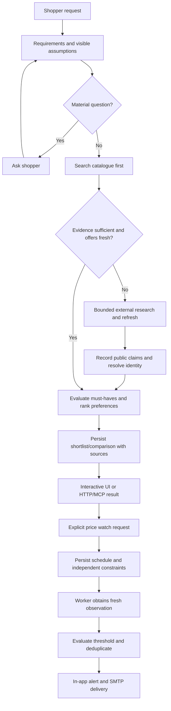

# shopping-assistant: Open source Netherlands shopping assistant

> Changed since: first version. Product interview confirmed; generated implementation plan awaits review. No build is authorized by this document.

## Summary

| Field | Value |
|---|---|
| What changes | Build an English/Dutch shopping assistant for all product categories in the Netherlands, with research, comparisons, offers, and daily price watches in its first public release. |
| Size | Project: repository contains documentation only, without application code. |
| Footprint | Three applications, shared core and supporting packages, Docker Compose, documentation, and 12 delivery stories. All paths below are proposed. |
| Decisions needed | No open product decisions. Concrete providers and numeric operational defaults require documented investigation and calibration during implementation. |
| Top risk | Incorrect variant matching or stale evidence causes misleading recommendations and false price alerts; use provenance, explicit uncertainty, fresh observations, and behavioral checks. |

Repository baseline: no Git repository exists, so base_commit is omitted. Existing vocabulary is in ../CONTEXT.md; historical interview decisions are in ../docs/decisions.md. This document consolidates the interview, including the final accepted Q40–Q45. None of the proposed code or verification commands has been implemented or run.

## Product brief

The assistant turns shopper descriptions into explicit must-have requirements and preferences, asks material clarifying questions, searches the local catalogue first, evaluates evidence sufficiency, and researches externally when needed. It returns justified recommendations, uncertain candidates separately, source links, product details, and interactive comparisons. All categories are eligible; universal retailer coverage or complete category-specific knowledge is not promised. Missing evidence is visible.

Initial offers are from business retailers delivering to the Netherlands in EUR. New condition is the default; refurbished is explicit opt-in. Exclude private sellers and auctions. End purchase assistance at retailer links. Rank by fit and evidence, independent of affiliate revenue; disclose affiliate links.

Delivered totals include VAT and known mandatory shipping. Unknown delivery means an incomplete total, not a claim of cheapest delivery. Conditional discounts are separate unless the shopper qualifies. Default to Netherlands-wide delivery; request an optional saved postcode only when material, and share it only with relevant providers. Current listings and observed price history are launch scope; advertised discounts remain retailer claims unless observed evidence supports them.

Public release includes all three workflows: needs-based shortlisting, product comparisons, and offer discovery with durable price monitoring. Incremental stories do not reduce that release scope. No imposed completion date or user-count target exists.

## Decisions

All selected options below are **decided** through explicit user answers or acceptance of recommendations. Options describe material alternatives, not unresolved questions.

| ID | Choice and alternatives | Selected recommendation | Consequence |
|---|---|---|---|
| D1 | Narrow category launch vs all-category support | All categories, Netherlands, English and Dutch | Flexible attributes and explicit evidence gaps; no fixed-category launch restriction. |
| D2 | Single-user ownership vs workspace boundary | Workspace-owned private data, initially one user | Future multiple-workspace hosting without mixing private data. |
| D3 | Private catalogue per workspace vs shared public facts | Shared public facts/offers with provenance in hosting; independent self-hosted catalogues | Public facts and private shopper intent must be separated at ingestion and access boundaries. |
| D4 | Closed premium features vs self-hosted feature availability | Keep shopping capabilities self-hostable; paid hosting, managed monitoring, optional usage | Hosting/service operations provide differentiation; affiliate payments never determine ranking. |
| D5 | Permissive licensing vs network source-sharing obligations | AGPL-3.0-or-later | Future hosted modifications carry applicable source-sharing obligations too. |
| D6 | Business logic per transport vs shared engine | Core owns authorization and operations; thin HTTP/MCP; built-in tools call core | Direct calls must enforce the same permissions as network adapters. |
| D7 | Monolithic request process vs durable worker | Separate web/API, worker, and MCP apps; PostgreSQL-backed durable jobs initially | Research and monitoring can survive restarts without introducing a separate queue service by default. |
| D8 | Mixed stack vs shared TypeScript stack | TypeScript, pnpm workspaces, Next.js web/HTTP, Node worker/MCP | Core remains independent of the web framework; versions chosen from current supported documentation. |
| D9 | Open signup vs controlled provisioning | Email/password, administrator invitations, public registration off | Document recovery; keep identity implementation replaceable. |
| D10 | Vendor-locked providers vs adapter interfaces | Tested launch set, compatible/local AI endpoint, separate search/data and SMTP | Compatibility must be verified per capability; no claim to support every provider/model. |
| D11 | Unbounded autonomy vs scoped operations and budgets | Bounded research, separate monitoring budget, workspace credential overrides | Stop visibly on limits; personal-key background usage requires opt-in; explicit watch requests execute directly. |
| D12 | Chat-only output vs persisted interactive resources | Chat plus product/comparison/watch views and session navigation | Historical results remain readable and distinct from fresh offers. |
| D13 | Price-only rows vs evidence and variant model | Product → variant → offer → timestamped observations, with source claims | Uncertain identity cannot silently satisfy an exact-variant comparison or watch. |
| D14 | Private-only tool use vs external assistants | External MCP launch support with scoped workspace access | No shopping tool exposes provider secrets or administrator configuration. |

Licence reference verified during interview: https://www.gnu.org/licenses/agpl-3.0.html#section13 . Concrete library, protocol, authentication, and provider implementation details require current primary-source verification before code; this plan makes no unverified API claims.

## Context changes

| Kind | Change | Canonical location |
|---|---|---|
| Glossary | Reuse existing product, variant, offer, price observation, workspace, requirement, and preference vocabulary without duplication | ../CONTEXT.md |
| Contract | Add the accepted runtime, access, evidence, monitoring, and budget contracts below on plan approval | .specshape/context.md |
| Rule | Product interview is complete; no implementation yet; preserve all three launch workflows and all-category scope | .specshape/context.md |

## Shape

```text
apps/
  web/                Next.js UI, HTTP routes, chat streaming, first-run administration
  worker/             Durable research, scheduled checks, delivery, retention jobs
  mcp/                Authenticated external shopping tool server
packages/
  core/               Shopping use cases, authorization, validation, provider ports
  db/                 PostgreSQL storage, migrations, transaction and job persistence
  agent/              Vercel AI SDK agent, typed tools, skills, context management
  providers/          AI capability configuration, search/data adapters, SMTP adapter
  auth/               Identity/session adapter and scoped client credentials
  ui/                 Shared structured product/comparison/watch components
compose.yaml          Complete production-oriented local stack
compose.dev.yaml      Development overrides
.env.example          Configuration names, no real credentials
README.md             Setup, limitations, operations and recovery
LICENSE               AGPL text and applicable notices
```

All paths are proposed; module names can be refined without changing ownership boundaries. The agent package depends on core operations, not HTTP or MCP round trips. Core receives an authenticated principal and trusted workspace scope; supplied workspace IDs alone never authorize access. Invalid inputs are rejected consistently by core operations, even for direct callers, with structured errors translated by HTTP/MCP. No provider call occurs for unauthorized or invalid work.

### Module contracts

| Boundary | Responsibility | Observable outcome |
|---|---|---|
| Identity → core | Trusted principal, workspace membership, operation scopes | Missing/revoked access denied before data access or spending. |
| Agent → core | Validate requirements, search, start/cancel/continue research, compare, manage watches | Typed persisted results and progress; explicit assumptions and partial status. |
| HTTP/MCP → core | Map validated transport inputs and trusted identities | Same operation permissions and results; structured invalid-input failures. |
| Core → providers | Provider-independent search, retrieval, offer refresh, model execution, delivery | Capability checks, provenance, usage accounting, bounded retries and explicit failures. |
| Worker → storage | Persisted leases, attempts, checkpoints, notification intent | Restart-safe execution and deduplicated effects; do not assume exactly-once delivery. |

Agent skills are curated application instructions, not instructions supplied by retailer pages. Retrieved content is untrusted evidence: it cannot override tool authorization, expose credentials, or trigger arbitrary operations. Context management persists structured requirements and result references, bounds model context, and preserves sources through summarization. Externally supplied MCP connections are not required for initial built-in tools; shopping MCP is an outward-facing interface.

### Data model

| Scope | Records | Important relationships |
|---|---|---|
| Installation | Configuration, encrypted administrator provider credentials, provider capabilities | Encryption secret resides outside the database; no plaintext secret in logs, model context, or browser responses. |
| Workspace/private | Membership, credentials, sessions, requirements, saved preferences, research runs, comparisons, watches, alerts, budgets | Every access checks the owning workspace. Private prompts and preferences never become shared catalogue facts. |
| Public catalogue | Products, variants, retailers, offers, observations, sources, claims, resolved attributes | Separate discovered claims from resolved attributes; retain conflicts, times, and identity uncertainty. |
| Execution | Jobs, leases, attempts, usage reservations, notification delivery state | Link private work to workspace; use deterministic notification identities and transactional state changes. |

Use shared product fields with category-specific attributes and explicit unknown/inapplicable values. Manufacturer evidence is preferred for specifications; retailer evidence for offers. Search snippets discover candidates, not verified specifications. Store monetary values precisely with currency, and preserve price basis/conditions. Detailed SQL, indexes, retention defaults, job library, identity implementation, and token lifecycle are story-level work, requiring relevant database/security guidance before authoring.

### Main flows



### Evidence and research contract

Ask questions only when answers materially change results; otherwise expose correctable assumptions. Never silently relax must-haves. Verified matches are fully recommended; uncertain candidates remain separate. Reuse sufficiently sourced specifications, refresh volatile offers, and search when evidence or candidate coverage is inadequate. Preserve conflicting claims rather than overwriting them with confidence invented by the model.

Each run has configurable time, calls, candidates, and spending caps. Support cancellation and explicit continuation; provide evidence-backed partial results on exhaustion or failure. Installation limits are hard ceilings and workspace overrides cannot bypass them. Reserve usage before concurrent paid work; where a provider cannot expose a strict monetary ceiling, bound calls/tokens conservatively and disclose estimates rather than claiming exact cost guarantees. Interactive and background budgets are separate. No silent paid fallback or change in data destination.

### Monitoring contract

Watch an exact offer or established variant, preserving condition and delivery constraints when sellers change. Default checks are daily in Europe/Amsterdam. Show last successful check and failures. After downtime, check now and disclose gaps rather than infer history.

Target alerts fire on threshold crossing, including one initial notification if the fresh creation-time price already meets the target. Price-drop watches establish the first successful observation as baseline; after notification compare future drops against the last notified price, applying configurable absolute/percentage minimum decrease. Suppress duplicate notifications for the same qualifying price; detailed rearming transitions must be covered by story-level examples.

Fresh successful observations are required for alerts. In-app alerts appear immediately; email respects configurable quiet hours and rechecks relevance before delayed delivery. Watches support daily scheduling and pause/resume. Bounded retries and delivery identities prevent application-generated duplicate sends; document any SMTP uncertainty after ambiguous delivery failures. Email failure does not remove the in-app alert. Watch settings remain independent when the originating session changes or is deleted.

### Setup, access, and operations

First-run administration is claimed once with a documented secure setup flow. Authenticate stored sessions and watches; invite users instead of public signup. Provide sign-out, credential rotation/revocation, scoped MCP client credential management, and administrator recovery; token transport/expiry details are selected and verified within the access story. Development binds locally by default. Production documentation covers HTTPS termination, externally reachable services, secrets, migrations, backup/restore, and recovery; local-model operation does not eliminate external search requirements.

Provider setup includes connection and capability checks, administrator/workspace keys, opt-in personal-key monitoring, and explicit availability status. Launch provider selection is delegated to the implementation agent: document Netherlands coverage, evidence links, freshness, costs, and limitations; verify at least one hosted AI integration, configurable compatible/local endpoint, useful search/data route, and SMTP. If no available route meets acceptance, report the concrete blocker rather than substituting fabricated evidence.

Private retention and deletion are configurable and must cover derived private records. Session deletion does not delete independent watches or public facts. Persist only source excerpts/metadata needed for evidence by default. Keep saved data, catalogue browsing, comparisons, and watch management usable during provider outages.

## Stories

All stories are not planned: detailed tasks and check commands belong to subsequent story planning. Every story includes implementation and behavioral verification at its public boundaries, not a deferred testing story. Independent readiness does not mean the first public release can omit other required workflows.

| Story | Goal | Acceptance summary | Needs | Planning state |
|---|---|---|---|---|
| shopping-assistant.1 | Walking skeleton | Compose boots PostgreSQL and web; one seeded product is read through core and HTTP into UI | — | not planned |
| shopping-assistant.2 | Workspace access and setup | First administrator, invitations, sign-in/out, private ownership, scoped MCP credentials and recovery | .1 | not planned |
| shopping-assistant.3 | Provider setup and spending control | Working launch providers, encrypted keys, capability checks, bounded usage and explicit fallback | .2 | not planned |
| shopping-assistant.4 | Evidence-backed catalogue | Product/variant/offer/claims ingestion, source conflicts, precise totals, search and refresh | .3 | not planned |
| shopping-assistant.5 | Durable job execution | Persisted work, cancellation, restart recovery, retries, scheduled execution and deduplication | .2 | not planned |
| shopping-assistant.6 | Needs-based agent research | English/Dutch clarification, catalogue-first research, verified shortlist, partial results and bounded context | .3, .4, .5 | not planned |
| shopping-assistant.7 | Interactive shopping workspace | Session navigation, cards/details, comparisons, saved preferences and history semantics | .6 | not planned |
| shopping-assistant.8 | Price watches | Offer/variant watches, daily fresh checks, thresholds, baseline and seller constraints | .4, .5 | not planned |
| shopping-assistant.9 | Alert delivery and schedules | In-app/email delivery, quiet hours, relevance recheck, pause/resume and deduplication | .3, .8 | not planned |
| shopping-assistant.10 | External HTTP/MCP capabilities | Authenticated search/research/compare/watch operations with consistent permissions | .2, .7, .9 | not planned |
| shopping-assistant.11 | Self-hosted operations and retention | Production/dev Compose, recovery, private deletion, source-sharing notices and degraded operation | .7, .9, .10 | not planned |
| shopping-assistant.12 | Release acceptance evidence | Reproducible fixtures, opt-in live smoke test, complete workflows and documented coverage | .11 | not planned |

Dependencies — children depend on parent; additional prerequisites are shown explicitly:

```text
shopping-assistant.1
└── .2
    ├── .3
    │   └── .4
    │       ├── .6 [also .3, .5]
    │       │   └── .7
    │       └── .8 [also .5]
    │           └── .9 [also .3]
    └── .5
Join: .10 needs .2 + .7 + .9
Join: .11 needs .7 + .9 + .10
└── .12
```

### Story acceptance detail

**shopping-assistant.1 — Walking skeleton.** Goal: prove one real storage-to-screen path. Acceptance: documented development Compose startup, migrations, a seeded catalogue product, core read through HTTP into UI, invalid-ID behavior, process health, and an integration check. This story does not claim authentication, research, or monitoring readiness.

**shopping-assistant.2 — Workspace access and setup.** Goal: safely own private shopping data. Acceptance: first-run administrator claim; invitation and password workflows; trusted workspace principal; sign-out, expiry and revocation; scoped MCP client credentials with operator rotation/revocation controls; no public signup by default; recovery procedure; two-workspace isolation checks including direct core calls and tampered identifiers. External transport verification completes in .10.

**shopping-assistant.3 — Providers and spending.** Goal: configure usable shopping dependencies. Acceptance: primary-source capability matrix and provider choices; verified hosted AI, compatible/local endpoint, search/data and SMTP routes; encrypted administrator/workspace keys; masked configuration output; explicit personal-key background consent; missing-provider states; concurrency-safe usage accounting; capped interactive/background spending and visible exhaustion; no silent provider fallback; invalid configuration rejected before a paid call. Live checks use configured credentials, not committed secrets.

**shopping-assistant.4 — Catalogue.** Goal: retrieve trustworthy reusable facts and offers across categories. Acceptance: exact/uncertain variant identity, provenance and conflicting claims, typed common and category attributes, source excerpt minimization, EUR/VAT/shipping/conditional-price representation, Netherlands delivery and optional postcode handling, new/refurbished filters, persisted price history, affiliate disclosures without ranking influence, idempotent ingestion, catalogue search and fresh-offer retrieval. Verify with heterogeneous category fixtures and conflicting configuration examples.

**shopping-assistant.5 — Durable execution.** Goal: reliably run persisted work independently of HTTP lifetimes. Acceptance: persisted queues/checkpoints, leases and bounded retries, cancellation/continuation, restart recovery, no reconstructed missed observations, visible persistent failures, schedule timezone handling, budget checks on retries, idempotent effects and observable job state. Verify with worker restart and concurrent-worker scenarios.

**shopping-assistant.6 — Research agent.** Goal: turn descriptions into evidence-backed shortlists. Acceptance: English/Dutch inputs and responses; must-haves/preferences; material clarification and visible assumptions; catalogue-first sufficiency decision; fresh offers and bounded external research; uncertain results separated; cancellation/continuation/partial status; source-linked persisted results; curated skills, typed tools and bounded context preserving requirements; untrusted retrieved instructions cannot change permissions or reveal secrets. Verify fit, missing evidence, provider outage, limits, and prompt-injection fixtures at agent/core boundaries.

**shopping-assistant.7 — Interactive UI.** Goal: revisit and manipulate structured shopping results. Acceptance: session navigation, product cards/details, requirement-driven comparison tables including cross-category/unknown/inapplicable cells, explicit saved preferences, fresh-versus-historical display, progress and cancellation, accessible English/Dutch controls and error states. Private content stays isolated; provider outages retain saved-data views.

**shopping-assistant.8 — Watches.** Goal: monitor exact offers or variants. Acceptance: explicit requests create/edit a displayed configuration; ambiguous targets prompt clarification; bulk destructive changes require confirmation; independent watch snapshot; daily Amsterdam checks; fresh observation requirement; target crossing including already-met initial target; initial price-drop baseline and subsequent last-notified comparison; minimum decreases; seller changes preserve constraints; duplicate-price suppression; downtime gaps; invalid inputs and insufficient identity rejected. Test rearming and repeat-price sequences explicitly.

**shopping-assistant.9 — Notifications.** Goal: deliver relevant alerts without repeated application sends. Acceptance: persisted in-app alerts, SMTP email, configurable quiet hours and daily scheduling, pause/resume controls, delayed-email relevance recheck, last-successful-check visibility, bounded delivery retries, deduplication across workers/restarts, and visible email failure while retaining in-app alerts. Document SMTP ambiguous-delivery behavior.

**shopping-assistant.10 — External interfaces.** Goal: use the same capabilities from external clients. Acceptance: documented HTTP contracts and MCP schemas for search, research lifecycle, comparison, and watches; scoped authenticated workspace access; consistent core error mapping and validation; no admin/secret tools; tested expiry/revocation, unauthorized calls, explicit write intent and destructive bulk confirmation; external client end-to-end examples. Select MCP transports and authentication using current primary documentation before implementation.

**shopping-assistant.11 — Operations.** Goal: run and maintain the whole self-hosted system. Acceptance: production and development Compose paths, documented provider/setup requirements and unavailable states, HTTPS and network exposure guidance, migration ordering, encrypted-secret handling, backup/restore and administrator recovery demonstrations, deletion/retention including derived private data, preserved independent watches/public facts, AGPL licence/notices and source access, provider outage behavior. Hosted billing, hosted deployment, and premium infrastructure are not required.

**shopping-assistant.12 — Release evidence.** Goal: demonstrate the complete accepted release. Acceptance: repeatable recorded-provider fixtures and separately configured live smoke flow; both languages and all three workflows; all-category architecture demonstrated across heterogeneous categories without claiming universal retailer coverage; exact-variant/conflict/freshness examples; external MCP use; workspace isolation; spending exhaustion; cancellation/recovery; notification deduplication; quiet hours; full Compose startup and restore evidence. Maintain documented numeric defaults, observed limits, provider coverage and known limitations. This story consolidates checks already delivered with each behavior, rather than introducing their first tests.

## Behaviour changes and risks

| Risk | Observable effect | Mitigation/check |
|---|---|---|
| False variant match | An 8 GB offer satisfies a 16 GB watch | Identity fixtures, uncertainty labels, refusal to verify ambiguous identity. |
| Stale or contradictory evidence | Unsuitable products appear fully recommended | Source timestamps/conflicts; strict must-have evaluation; fresh observations before alerts. |
| Concurrent usage exceeds budget | Background and chat calls overspend a shared allowance | Atomic reservations, bounded retries, conservative provider limits and visible estimate limitations. |
| Crash during notification | Duplicate email or missed alert | Durable delivery intent, application deduplication and explicit ambiguous SMTP failure policy. |
| Private data enters shared catalogue | Shopper preferences become visible to another workspace | Public-fact admission boundary and cross-workspace tests. |
| Arbitrary source instructions | Retrieved page manipulates tools or exposes credentials | Treat retrieved text as evidence, constrain tools and test malicious-source fixtures. |
| Provider coverage cannot substantiate a result | Assistant invents specifications or offers | Honest partial results; verified capability matrix; no fake fallback. |

Out of scope: checkout and autonomous purchasing; auctions/private sellers; broad requirement watches; coupon discovery; worldwide markets; mandatory unrestricted scraping; hosted billing/deployment; universal provider/model compatibility. Back-in-stock alerts and broader saved-search monitoring remain future feature candidates, not launch commitments.

## Alternatives rejected

- Narrow-category release: user explicitly requires all-category support.
- Feature-gated self-hosting: user chose shopping-feature availability and service-based monetization.
- Agent calls to its own MCP server for every tool: direct typed calls keep authorization centralized without mandatory transport overhead.
- Request-bound monitoring: cannot satisfy daily durable checks and restart recovery.
- Fully dynamic anonymous setup: conflicts with owned sessions, private credentials and workspace separation.
- Provider names selected from memory: delegated selection requires current primary-source capability review.
